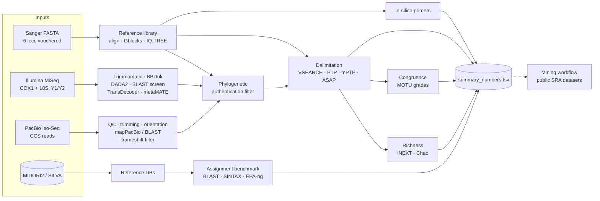

# Facetotecta reference library

**A reproducible Snakemake workflow that makes the dark diversity of crustacean y-larvae (Facetotecta) detectable in DNA sequencing data.**

[](https://snakemake.github.io)
[](LICENSE)
[](https://github.com/NiklasDreyer/facetotecta-reference-library/actions/workflows/checks.yml)


This repository holds the complete analysis pipeline for the manuscript:

> Dreyer N., Olesen J., Jensen M. R., Bernot J. P., Wong Y. H., Machida R., Chan B. K. K. *A voucher-linked reference library makes the dark diversity of crustacean y-larvae (Facetotecta) detectable in high-throughput sequencing data.* In preparation for *Molecular Ecology Resources*.

---

## Contents

- [Background](#background)
- [What the pipeline does](#what-the-pipeline-does)
- [Quick start](#quick-start)
- [Repository layout](#repository-layout)
- [Documentation](#documentation)
- [Citation](#citation)
- [Authors and contact](#authors-and-contact)
- [License](#license)

---

## Background

Metabarcoding and environmental DNA (eDNA) surveys can only report organisms whose sequences can be matched to a reference. Groups without curated reference sequences stay invisible, even when they are common. These are often called **dark taxa**.

**Facetotecta** are an extreme case. This group of pancrustaceans was discovered more than a century ago (Hansen 1899) and is known almost entirely from its planktonic **y-larvae**. Y-larvae occur from Arctic waters to tropical coral reefs and from the intertidal to hadal depths, yet:

- the **adults have never been found**; the life cycle (y-nauplii → y-cyprid → ypsigon) suggests they are endoparasites of unknown hosts, like the parasitic rhizocephalan barnacles
- only **16 species are formally described**, two of them with DNA sequences
- wild-caught larvae **cannot be identified to species** from morphology alone
- **no metabarcoding or eDNA study had reported Facetotecta**, because there were almost no reference sequences to match

### What the study does

1. **Builds a voucher-linked reference library.** Several hundred y-larvae were collected in Okinawa, Taiwan, the Azores, Malaysia, the White Sea and Antarctica. Each was reared individually, video-recorded through development, slide-mounted as a voucher and Sanger-sequenced for up to six loci (COX1, 12S, 16S, 18S, 28S, H3).
2. **Combines three kinds of sequencing** from Sesoko Island, Okinawa, a site with exceptionally high y-larva diversity:
   - Sanger sequences from single specimens
   - Illumina COX1 and 18S amplicons from bulk samples of hand-sorted larvae
   - PacBio Iso-Seq long reads (cDNA) from about 3,600 pooled larvae, which are largely free of nuclear mitochondrial pseudogenes (NUMTs)
3. **Delimits lineages (MOTUs)** with several methods, measures how far they agree, and estimates how complete the sampling is.
4. **Tests the library as a tool.** It measures how often reads from other crustaceans would be wrongly called Facetotecta, and whether standard metabarcoding primers match y-larvae at all.
5. **Mines public metabarcoding data**, recovering facetotectan sequences that earlier studies had left "unassigned", from ocean basins worldwide.

Preliminary analyses (manuscript_v1) delimited well over a hundred molecular lineages, far more than the described fauna, with more than a hundred COX1 lineages at Sesoko Island alone. This workflow re-derives every one of those numbers from the raw data in one reproducible run, and adds the validation analyses described below.

More detail: **[docs/background.md](docs/background.md)**

---

## What the pipeline does



| Module | Main tools | Manuscript section |
|---|---|---|
| Sanger reference library | MAFFT, Gblocks, IQ-TREE 2 (ModelFinder, UFBoot, SH-aLRT) | 2.2, 2.6 |
| Illumina amplicons | FastQC, Trimmomatic, BBDuk, DADA2, BLAST+, TransDecoder, metaMATE | 2.4, 2.7 |
| PacBio Iso-Seq | NanoPlot, BBTools (mapPacBio.sh), minimap2, BLAST+ | 2.5, 2.8 |
| Authentication | VSEARCH, MAFFT, Gblocks, IQ-TREE 2, ete3 | 2.9 |
| Species delimitation | VSEARCH, PTP and mPTP, ASAP | 2.10 |
| Richness and overlap | iNEXT, UpSetPlot | 2.11 |
| Assignment benchmark | BLAST+, SINTAX, EPA-ng, gappa, RAxML-NG | 2.12 |
| In-silico primer coverage | custom IUPAC-aware scanner | 2.13 |
| Public-data mining | SRA Toolkit, cutadapt, DADA2, BLAST+, EPA-ng | 2.14 |

Every number quoted in the manuscript is written to **`results/summary_numbers.tsv`**, so the text can be filled from a single file.

---

## Quick start

```bash
# 1. Get the code (on your cluster's login node)
git clone git@github.com:NiklasDreyer/facetotecta-reference-library.git
cd facetotecta-reference-library

# 2. Install Snakemake, the SLURM plugin and every tool (conda/mamba)
bash install.sh

# 3. Add your data and settings
#    data/sanger/*.fasta, config/*.tsv, config/config.yaml, profiles/slurm/config.yaml

# 4. Run
conda activate yfacet-snakemake
snakemake --profile profiles/slurm -n        # dry run
snakemake --profile profiles/slurm           # main workflow
snakemake -s workflow/Snakefile_mining --profile profiles/slurm   # public datasets
```

Step-by-step instructions: **[docs/installation.md](docs/installation.md)** and **[docs/running.md](docs/running.md)**

---

## Repository layout

```
├── config/                  parameters and sample tables
├── profiles/slurm/          SLURM profile for Snakemake 8
├── workflow/
│   ├── Snakefile            main workflow
│   ├── Snakefile_mining     public-data workflow
│   ├── rules/               one rule file per module
│   ├── envs/                one conda environment per tool group
│   └── scripts/             every step as a commented, stand-alone script
├── resources/               outgroups, reference COX1, PacBio oligos, databases
├── data/                    input data (raw reads are not tracked by git)
├── docs/                    full documentation
├── tests/                   syntax and toy-data checks (run by GitHub Actions)
└── install.sh               one-command installation
```

---

## Documentation

| Page | Content |
|---|---|
| [Background](docs/background.md) | The biological question and the study design |
| [Installation](docs/installation.md) | Conda, Snakemake, SLURM plugin, ASAP |
| [Inputs](docs/inputs.md) | Every input file and its format |
| [Configuration](docs/configuration.md) | All parameters, with the values used in the manuscript |
| [Running](docs/running.md) | Dry runs, partial runs, the mining workflow, reruns |
| [Workflow](docs/workflow.md) | Each module step by step, with tools and settings |
| [Outputs](docs/outputs.md) | What every result file contains, and which figure or table it feeds |
| [Methods changes](docs/methods-changes.md) | Changes from manuscript_v1, to report in the Methods |
| [Troubleshooting](docs/troubleshooting.md) | Version-dependent steps to check on the first run |

---

## Citation

If you use this workflow or the reference library, please cite the manuscript (details will be added on publication) and this repository. A Zenodo DOI for the archived code will be added at publication. Citation metadata is in [`CITATION.cff`](CITATION.cff); GitHub shows it under **"Cite this repository"**.

---

## Authors and contact

| | |
|---|---|
| **Niklas Dreyer** (corresponding) | Natural History Museum of Denmark, University of Copenhagen · dreyer@snm.ku.dk |
| **Benny K. K. Chan** (corresponding) | Biodiversity Research Center, Academia Sinica · chankk@as.sinica.edu.tw |
| Jørgen Olesen | Natural History Museum of Denmark, University of Copenhagen |
| Mads Reinholdt Jensen | UiT The Arctic University of Norway |
| James P. Bernot | University of Connecticut |
| Yue Him Wong | Shenzhen University |
| Ryuji Machida | Academia Sinica |

Questions and problems: please open an [issue](../../issues). Contributions are welcome; see [CONTRIBUTING.md](CONTRIBUTING.md) and the [Code of Conduct](CODE_OF_CONDUCT.md).

---

## License

The code is released under the [MIT License](LICENSE). Sequence data, once deposited in GenBank, BOLD and SRA, are governed by those repositories' terms.
